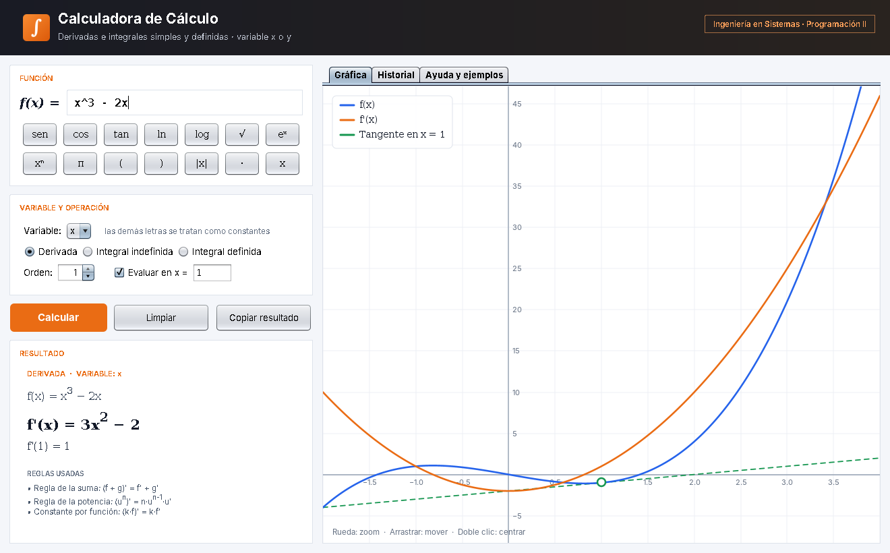

# Calculadora de Cálculo — Integrales y Derivadas

Proyecto #3 · Programación II · Ingeniería en Sistemas

Calculadora de escritorio en **Java Swing (JFrame)** con **programación orientada a objetos**. Resuelve:

- **Derivadas** de orden 1 a 5, evaluadas en un punto (con recta tangente) y parciales.
- **Integrales indefinidas** (potencia, sustitución, por partes, fracciones parciales, identidades trigonométricas, completar el cuadrado).
- **Integrales definidas** con F(b) − F(a), comprobación numérica con Simpson y detección de integrales impropias.
- Selección de la **variable x o y** (las demás letras se tratan como constantes).
- Gráfica con zoom, historial y ejemplos listos.



---

## 1. Abrir en IntelliJ IDEA

1. **File → Open…** y elige la carpeta `CalculadoraCalculo` (la que tiene `pom.xml`).
2. Si pregunta, elige **Open as Project** y **Trust Project**. IntelliJ lo reconoce como proyecto Maven y descarga JUnit solo.
3. Revisa que el JDK sea **17 o más nuevo**: *File → Project Structure → Project → SDK*.
4. Abre `src/main/java/calculadora/Main.java` y presiona el botón verde ▶ **Run 'Main.main()'**.

## 2. Pruebas automáticas

Clic derecho en `src/test/java/calculadora/CalculadoraTest.java` → **Run 'CalculadoraTest'**. Son 9 pruebas: analizador, derivadas, integrales indefinidas, definidas, método numérico e integral impropia.

## 3. Generar el JAR

- **Ya viene uno listo:** `dist/CalculadoraCalculo.jar` (doble clic, o `java -jar dist/CalculadoraCalculo.jar`).
- **Para generarlo de nuevo:** panel **Maven** (lado derecho) → *Lifecycle* → doble clic en **package**. Queda en `target/CalculadoraCalculo.jar`.

## 4. Subir a GitHub

1. **VCS → Share Project on GitHub** (o *Git → GitHub → Share Project on GitHub*), nombre del repositorio: `CalculadoraCalculo`.
2. En GitHub: **Settings → Collaborators → Add people** y agrega a la catedrática y a los otros dos integrantes.
3. Cada integrante clona el repositorio (*File → New → Project from Version Control*) y hace sus propios commits (**Ctrl + K** para commit, **Ctrl + Shift + K** para push). Así queda registro de que los 3 participaron.

---

## 5. Estructura del proyecto

```
src/main/java/calculadora/
├── Main.java                 Punto de entrada
├── modelo/                   ÁRBOL DE EXPRESIONES (patrón Composite)
│   ├── Expresion.java        Clase abstracta: evaluar, derivar, simplificar, sustituir
│   ├── Constante, Variable   Hojas del árbol
│   ├── Suma, Resta, Producto, Division, Potencia, Negacion, Funcion   Nodos con hijos
│   ├── TipoFuncion.java      enum: sen, cos, ln... con su derivada e integral
│   ├── Polinomio.java        Derivar/integrar término a término, dividir polinomios
│   ├── Simplificador.java    Junta términos semejantes, cancela factores, ordena
│   └── Numeros, Fraccion, Ops   Formato de números y atajos
├── logica/                   OPERACIONES Y ALGORITMOS
│   ├── AnalizadorSintactico  Texto → árbol (análisis léxico + descenso recursivo)
│   ├── Operacion.java        Clase abstracta: ejecutar(f) → ResultadoCalculo
│   ├── Derivada, IntegralIndefinida, IntegralDefinida   Subclases (polimorfismo)
│   ├── Integrador.java       Técnicas de integración simbólica
│   ├── IntegradorNumerico    Simpson adaptativo y búsqueda de discontinuidades
│   ├── Raices, Complejo      Raíces de polinomios (fracciones parciales)
│   └── ErrorCalculo, ErrorSintaxis   Excepciones propias
└── vista/                    INTERFAZ GRÁFICA (Swing)
    ├── VentanaPrincipal      JFrame principal
    ├── PanelGrafica          JPanel que dibuja las funciones
    └── FormatoHtml, Estilo, Consulta, Ejemplos, BotonPrincipal
docs/uml/                     Diagramas UML (PNG + código fuente .dot)
dist/CalculadoraCalculo.jar   Ejecutable para presentar
```

## 6. Cómo funciona (para la exposición)

### Paso 1 — Leer el texto (`AnalizadorSintactico`)
El texto `3x^2 + 5x` se separa en **tokens** (`3`, `x`, `^`, `2`, `+`, `5`, `x`) y luego se arma un **árbol** respetando la jerarquía de operaciones (potencia → multiplicación → suma). Si falta un paréntesis o hay un símbolo raro, lanza un `ErrorSintaxis` con la posición del error.

```
          Suma
        /      \
   Producto   Producto
   /    \      /    \
  3  Potencia 5      x
       /  \
      x    2
```

### Paso 2 — Derivar (polimorfismo)
`Expresion` es **abstracta** y cada subclase implementa su propia regla en `derivar()`:

| Clase | Regla que implementa |
|---|---|
| `Constante` | (k)' = 0 |
| `Variable` | (x)' = 1 |
| `Suma` / `Resta` | (f ± g)' = f' ± g' |
| `Producto` | (f·g)' = f'·g + f·g' |
| `Division` | (f/g)' = (f'·g − f·g') / g² |
| `Potencia` | (uⁿ)' = n·uⁿ⁻¹·u' y (aᵘ)' = aᵘ·ln(a)·u' |
| `Funcion` | regla de la cadena: f'(u)·u' |

Para derivar todo basta con `raiz.derivar("x")`: cada nodo llama a la derivada de sus hijos. Después el `Simplificador` limpia el resultado (`0·x² + 3·2x` → `6x`).

### Paso 3 — Integrar (`Integrador`)
Prueba técnicas en este orden y se queda con la primera que funcione:
1. Constante y **regla de la potencia** (polinomios).
2. **Linealidad**: separa la suma en integrales más pequeñas.
3. **Sacar constantes**: ∫k·f = k·∫f.
4. **Funciones racionales**: división de polinomios y **fracciones parciales**.
5. **Completar el cuadrado** para √(ax² + bx + c).
6. **Tabla + sustitución** u = g(x): revisa si el resto del producto es k·g'(x).
7. **Por partes** (método tabular y LIATE).
8. **Identidades trigonométricas** (sen² + cos² = 1, reducción de potencia).

Al final **comprueba** la respuesta: deriva F numéricamente y verifica que dé f en varios puntos.

### Paso 4 — Integral definida (`IntegralDefinida`)
1. Revisa que f sea continua en [a, b]; si tiene una asíntota, avisa que es **impropia**.
2. Si hay antiderivada: **Teorema Fundamental del Cálculo**, F(b) − F(a), con resultado exacto (π/4, e² − 1...).
3. Si no hay (por ejemplo e^(−x²)): **regla de Simpson adaptativa**.

### Conceptos de POO aplicados
- **Abstracción:** `Expresion` y `Operacion` son clases abstractas.
- **Herencia:** 9 clases heredan de `Expresion`; 3 de `Operacion`; `ErrorSintaxis` de `ErrorCalculo`.
- **Polimorfismo:** `derivar()`, `evaluar()` y `ejecutar()` se comportan distinto según el objeto.
- **Encapsulamiento:** atributos `private final` con getters; los nodos son inmutables.
- **Patrón Composite:** el árbol de expresiones.
- **Separación en capas:** `modelo` (datos), `logica` (algoritmos), `vista` (interfaz).

## 7. Cómo escribir funciones

| Operación | Escribe |
|---|---|
| Multiplicación | `3*x`, `3x`, `2sen(x)` |
| Potencia | `x^2`, `e^(2x)` (ojo: `e^2x` es e²·x) |
| Raíz | `√(x + 1)` o `sqrt(x + 1)` |
| Valor absoluto | `|x|` o `abs(x)` |
| Funciones | `sen cos tan cot sec csc asen acos atan senh cosh tanh ln log` |
| Constantes | `pi` o `π`, `e` |

Diagramas UML en `docs/uml/`: clases, casos de uso y actividad. Para regenerarlos: `dot -Tpng -Gdpi=150 clases.dot -o clases.png` (Graphviz).
